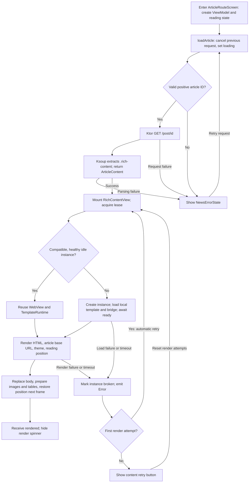

# WebView components

Install `WebViewPoolProvider` above navigation. `RichContentView` renders content through a local template;
`WebPageView` loads a complete HTML document or HTTP(S) URL. Native instances are private to a lease.
The pool keeps at most one idle local template and destroys ordinary pages on release.

## Adding a template

Keep HTML/CSS/business scripts in the owning feature. Extend `RichContentTemplate` and load its HTML
with that feature's Compose `Res.readBytes`. Keep the loader free of route/Activity captures: an idle
runtime retains its template. Change `revision` whenever the template or its resource dependencies change.
The tuple of id, revision, protocol version, base URL and native configuration defines reuse compatibility.

Put exactly one `<!-- APP_WEB_BRIDGE -->` before the template script, then define:

```javascript
window.AppContentTemplate = {
  async render(payload, context) {},
  async updateTheme(theme) {},
  async captureState() { return {scrollY: 0}; },
  async reset() {}
};
```

`render` receives `{html, baseUrl, scrollY, theme, templateData}`. `templateData` is an optional
template-owned JSON object for feature-specific data; the shared WebView layer does not interpret it.
`context.signal` aborts the old render on replacement
or reset. Use it on event listeners and cancel timers, animation frames, observers and outstanding tasks
on abort/reset. An async render must settle on cancellation. Reset must finish all cleanup before resolving.
Do not access the native bridge directly: keep the per-render `context` in event closures and use
`context.emit(event, data)`. Its immutable identity prevents late events from acting on the next document.
For async DOM changes also check `context.isCurrent()` after awaits.

Events: `scroll` (`{y}`), `linkClick` (`{url}`), `imageClick` (`{urls, index}`),
`templateMessage` (`{name, payload}`). Render completion, snapshots, reset acknowledgements and errors
are sent by the shared bridge. `captureState` uses CSS pixels. Persist reading state in the route.

Local templates retain their shell: handle links in the caller and return `Block`, or return
`OpenExternal`. Use `WebPageView` when navigation should replace the displayed page.
Only application-controlled local templates get the native message bridge; content fragments are
not sanitized by this component and must satisfy the feature's content trust policy.

## Ordinary pages

Pass `WebPageSource.Html(html, baseUrl)` or `WebPageSource.Url(url)`, optionally with a route-owned
`rememberWebPageState()`. The state exposes loading/errors/current URL/history flags and reload/back/forward.
A state may only have one mounted view. Commands after unmount do nothing; remount starts with the supplied
source rather than restoring history. No template hooks, CSS, theme or native message bridge are injected.
HTTP(S) navigation is allowed by default; custom schemes are blocked. Navigation decisions also cover
new windows, which open in the same view when allowed. Cookies and browser caches are not cleared globally.

`WebViewInteraction.Native` is the default and retains platform gestures and inertia.
`NestedScroll` coordinates the main document with any Compose nested-scroll parent: parent pre-scroll,
document scrolling of the remaining distance, then parent post-scroll with the document's consumption
and remainder. Parent consumption determines the order; no app-bar or screen state is consulted.
Single-finger vertical flings use Compose spline decay and the same allocation on every frame,
including pre/post-fling handoff and parent settling. New input, cancellation, multiple pointers and
release cancel the shared fling. Horizontal gestures, taps, long presses and multitouch remain native.
Independent HTML scroll regions and iframes do not gain nested-scroll support. Programmatic scrolling
and reading-position restoration do not drive parents. Platform adapters convert native coordinates
and velocities to Compose pixels and restore temporary settings on release.

## News detail loading flow

The news screen has two independent loading stages: fetching the article body, then rendering it in a
local template. It does not navigate the WebView directly to the remote article page.

1. `ArticleRouteScreen` collects `ArticleViewModel.uiState` and owns a
   `remember(articleId) { RichContentReadingState() }`, shared across detail layout changes.
2. `ArticleViewModel.loadArticle()` cancels the previous request, sets `isLoading = true`, validates the
   article ID, and calls `NewsRepository.getArticleContent()`.
3. `YingdiNetData` fetches the mobile article HTML through Ktor. Ksoup extracts the inner HTML of
   `.rich-content` on `Dispatchers.Default`. The repository returns `ArticleContent(articleId, html, baseUrl)`.
4. `ArticleDetailPage` shows the request spinner or `NewsErrorState`. Once content is available, it mounts
   `RichContentView` with `NewsDetailTemplate`, `contentKey = "news:<articleId>"`, and `NestedScroll` interaction.
5. `RichContentView` acquires and binds a lease from the application-level `WebViewPool`. A new runtime
   loads `news_detail.html` with the shared `template_bridge.js` injected and waits for the JS `ready`
   event. A reused runtime keeps its already initialized shell and skips this step.
6. `TemplateRuntime.update()` supplies the latest document, template data, and theme. Once ready, it
   sends `render` with the body HTML, article base URL, saved CSS-pixel scroll offset, theme, and
   `templateData.author`.
7. The news template replaces the body, sets its base URL and theme, renders the optional
   `templateData.author` profile bar, promotes image `data-src` when needed, wraps tables for
   horizontal scrolling, and restores the reading position on the next frame.
   The bridge then emits `rendered`, allowing `RichContentView` to hide its own spinner.

`rendered` means the template's render hook has completed, not that all images have loaded. Image
load/error events and a `ResizeObserver` continue correcting the restored position as layout changes;
user input stops this restoration. Scroll events update the route-owned reading state. This state is
in memory, not persisted across process recreation.

### Loading flowchart



Request retries call `ArticleViewModel.loadArticle()` and fetch the body again. Render retries only
reacquire a WebView instance and render the existing body. The first rendering error triggers one
automatic retry; another error shows the content retry button. Template assembly/resource loading,
waiting for `ready`, and waiting for `rendered` each have a separate 15-second timeout. Native load
failures and web content process termination also mark the runtime broken.

### Rendering and recycling sequence

```mermaid
sequenceDiagram
    participant UI as RichContentView
    participant Pool as WebViewPool
    participant RT as TemplateRuntime
    participant JS as WebView bridge and template
    UI->>Pool: acquire(template.reuseKey)
    Pool-->>UI: Lease with reused or new entry
    UI->>RT: bind(new leaseId, readingState, callback)
    Note over UI,RT: update(document, theme) supplies the latest body; render waits for ready
    opt First binding of a new instance
        RT->>JS: loadHtml(local template with injected bridge)
        JS-->>RT: DOMContentLoaded: validate hooks, emit ready
    end
    RT->>JS: render(html, baseUrl, scrollY, theme)
    JS->>JS: Reset old body, insert content, restore position next frame
    JS-->>RT: rendered
    RT-->>UI: Rendered: loaded = true
    JS-->>RT: scroll(y)
    RT->>RT: Update route-owned reading state
    UI->>Pool: On disposal: release(lease)
    Pool->>RT: unbind()
    RT->>JS: captureState (if ready and healthy)
    RT->>RT: Clear binding and callbacks; detach native view
    Pool->>RT: recycle()
    JS-->>RT: state(scrollY)
    RT->>RT: Save snapshot if reading binding still owns the position
    RT->>JS: reset
    JS->>JS: Abort render, remove listeners, cancel frames, stop media, clear body
    JS-->>RT: reset acknowledgement
    RT-->>Pool: Reusable if cleanup succeeds within 2 seconds
    Pool->>Pool: Keep only if open, healthy, and idle slot empty; otherwise destroy
```

## Reuse boundaries

`WebViewPool` reuses an entry only when it is already idle, its `WebViewReuseKey` exactly matches the
requested key, and it is not broken. Acquiring from a closed pool fails. Active and cleaning entries
are never borrowed, and acquisition does not wait for cleanup. An incompatible idle entry is destroyed.

| Reuse key field | Current news detail value | Compatibility requirement |
| --- | --- | --- |
| `mode` | `template` | Local templates and ordinary pages are different modes. |
| `configuration` | `templateBridge = true`, `javaScript = true`, `domStorage = false` | All native configuration fields must match. |
| `templateId` | `news.detail` | Both articles must use the same template identity. |
| `revision` | `2` | Bump when the template or its resource dependencies change. |
| `protocolVersion` | `1` | Host and template protocol versions must match. |
| Template `baseUrl` | `https://mob.iyingdi.com/` | The template loading base URL must match. |

Article ID, body HTML, article base URL, theme, and reading position are not part of this key. The
template base URL above is distinct from the per-article base URL, such as
`https://mob.iyingdi.com/post/202`, sent with `render` to resolve content-relative URLs.

### Example: read article A, then article B

1. With an empty pool, article A (`news:101`) creates WebView W1 and its `TemplateRuntime`, loads the
   local template and bridge, waits for `ready`, and renders A.
2. When A's view leaves composition, releasing its lease moves W1 out of active use. `captureState`
   saves A's reading position, then `reset` clears the content. Only after the acknowledgement can W1
   enter the idle slot, provided cleanup succeeded and no other idle entry occupies it.
3. Article B (`news:202`) still fetches its own body. If W1 is idle when B acquires a lease, both articles
   have the same news template reuse key, so B receives W1 with a new lease ID. W1 retains its template,
   bridge, and ready state; B binds its own reading state and sends a new `render` payload.
4. If B acquires while A is still mounted (for example, during a navigation transition) or W1 is still
   cleaning, W1 is unavailable and B needs another compatible idle entry or a new W2. W1 becoming idle
   later does not migrate B from W2 to W1.

The pool has one idle slot in total, not one slot per article or template. Multiple active instances
are allowed. Reuse saves native instance creation and template initialization, not the article request
or rebuilding the article DOM. Ordinary `WebPageRuntime` entries always decline recycling and are destroyed.

Within one binding, unchanged document/theme values do nothing; a theme-only change sends `updateTheme`,
and a document change sends `render`. Changing `contentKey` in `RichContentView` releases the old lease
and acquires another rather than directly transferring the active instance to the new article.

Late events cannot update the next article: the host validates instance/template identity, lease ID,
document version, content key, and render request ID. The JS bridge aborts the previous render context,
and reading-state owner tokens prevent an old snapshot from overwriting a newer binding's position.
